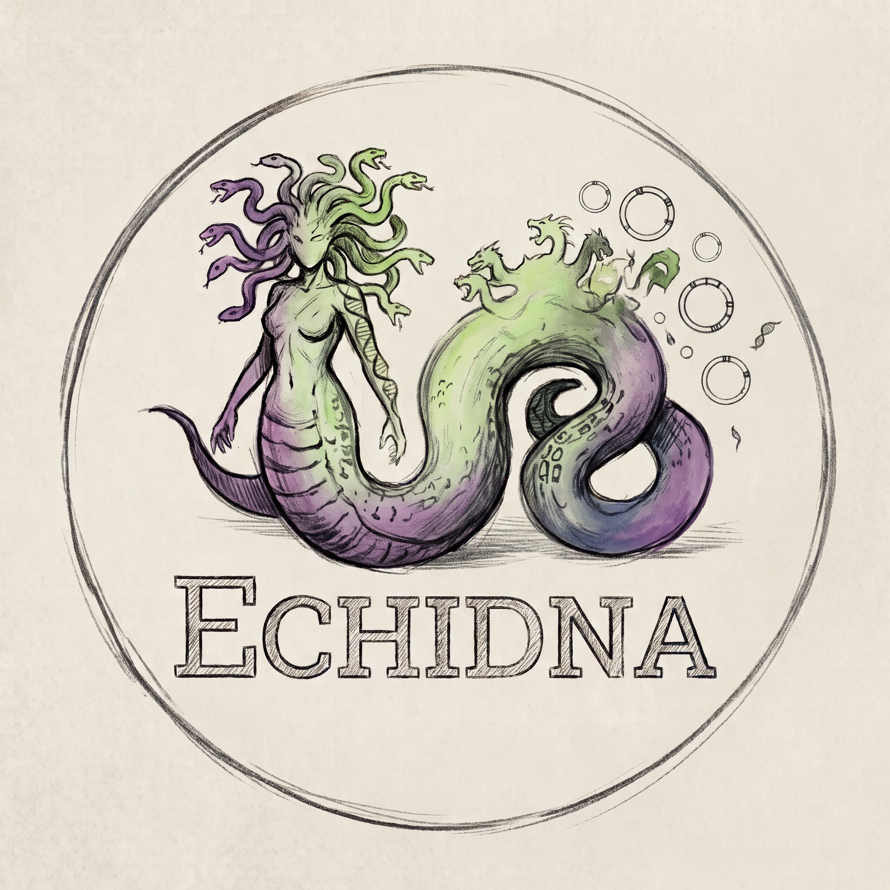

<p align="center">
  
</p>

# Echidna - metagenomic assembly, MAG integrity and chimera screening

A dependency-free Python toolkit for metagenomic assembly quality control: from a
raw assembly to quality-filtered, taxonomically classified genomes.

Echidna itself is pure Python (no dependencies) and installs in seconds. It
orchestrates standard tools (anvi'o, CheckM2, GTDB-Tk, GUNC, barrnap,
tRNAscan-SE, Kraken2, samtools, BLAST+), each in its own conda env.

The distribution name is **`echidnaxomics`**. The command and Python import remain
**`echidna`**. Install from the checkout below until a release is published;
`pip install echidna` installs an unrelated project.

## Documentation

For installation instructions, workflow tutorials, command details and guidance
on interpreting results, visit the [Echidna documentation](https://l-gallucci.github.io/echidna/).

## Quickstart

```bash
git clone https://github.com/l-gallucci/echidna.git
cd echidna
pip install -e .
echidna --help
```

That covers the dependency-free commands. Heavy commands additionally call
external tools, each installed in its own conda env - see
[docs/installation.md](docs/installation.md).

## Commands at a glance

Assembly QC and misassembly handling:

| Command | What it does |
|---|---|
| `run-anvi-misassemblies` | Detect soft-clipping misassembly positions (anvi'o wrapper, PacBio HiFi) |
| `process-large-contigs` | Extract, QC and filter large contigs before binning |
| `classify-clipping` | Label each clipping position (repeat / deletion / chimeric_join / ...) from BAM evidence |
| `filter-misassemblies` | Split or remove contigs at misassembly positions |
| `remove-hq-contigs` | Remove known HQ-genome contigs from an assembly |
| `check-zero-coverage` | Validate no-coverage regions via BLAST + k-mers |

Chimera detection:

| Command | What it does |
|---|---|
| `check-read-chimeras` | Chimeras from read-level taxonomy (Kraken2 or Kaiju + BAM) |
| `check-chimeras` | Per-bin chimera verdict from GUNC + per-contig taxonomy (CheckM2 / GTDB-Tk / GC reported) |
| `check-shared-contigs` | Report or resolve shared contigs; optional cluster replacements gated by reused contig taxonomy |
| `run-gunc` | Gene-level chimerism/contamination (GUNC wrapper) |
| `run-mmseqs-contigs` | MMseqs2 taxonomy on bin contigs -> per-contig TSV for `classify-contigs` |
| `classify-contigs` | Flag bins whose contigs span >=2 taxa (per-contig taxonomy foreign fraction) |
| `check-ssu-taxonomy` | Check each MAG's 16S agrees with its GTDB-Tk taxonomy (blastn) |

MAG quality and taxonomy:

| Command | What it does |
|---|---|
| `run-checkm2` | Completeness/contamination (CheckM2 wrapper) |
| `run-gtdbtk` | Taxonomy classification (GTDB-Tk wrapper) |
| `run-mimag-rna` | MIMAG rRNA (5S/16S/23S) + tRNA criterion (barrnap + tRNAscan-SE) |
| `organize-mags` | Split genomes into HQ/MQ/LQ, rename `<sample>__<taxon>__<orig>`, optional full-MIMAG HQ gate |
| `final-report` | Join per-MAG signals (CheckM2, GTDB-Tk, MIMAG, chimera, 16S) into one table |

One-command workflows (run a whole branch, each step in its own env):

| Command | What it does |
|---|---|
| `misassembly-wf` | Whole misassembly-cleaning branch (anvi -> process -> readchim -> classify -> filter) |
| `mag-quality-wf` | MAG QC workflow; optional overlap/taxonomy selection before fresh QC, with reuse of contig classifications |

Setup and environment helpers:

| Command | What it does |
|---|---|
| `setup-workflow` | Configure the Snakemake workflow (env yamls + config), optionally build envs |
| `fetch-databases` | Register existing databases, or download missing ones |
| `check-envs` | Report tool versions per conda env + Echidna compatibility |

Every subcommand has `-h/--help`.

## Interpreting results and reproducibility

Echidna has two branches: assembly cleaning (documented for PacBio HiFi reads
mapped back to their own assembly) and MAG QC after external binning. After
splitting contigs, remap reads to the modified assembly before computing depth
for a new binning run.

Quality tiers are intentional project defaults: HQ >=90% completeness / <=5%
contamination, MQ >=70% / <=10%, LQ >=50% / <=10%. `process-large-contigs` uses
its own 50%/10% extraction threshold. These labels are not strict MIMAG tiers.
When the optional RNA gate is requested, missing RNA results demote HQ to MQ.

Chimera screening is report-only: `Chimeric` and `Check` MAGs are not automatically
excluded from the organized quality folders. `Clean` means no anomaly in the
available measured signals, not proof that every signal was evaluated. GC,
CheckM2 contamination and GTDB-Tk warnings are informative columns. Prefer
GUNC/MMseqs2 references from the same taxonomy and release, in each tool's own
format. Read-level comparisons can use a common `--taxonomy-rank` with the
classifier's `--nodes-dmp`.

Use fresh output directories when changing inputs or thresholds: populated
`Selected/` folders are refused to prevent stale tier assignments. `--from` and
`--skip` assume prior outputs already exist and match the current run. Assembly
HQ removal and `--hq-list` use exact FASTA contig IDs, not numbers in bin names.
`final-report --organized-quality <merged_quality.tsv>` adds the effective
`organized_tier` alongside the historical CheckM2 `tier`; `--genomes-dir` adds
explicit circular annotations and a separate near-complete candidate flag.

Tests cover parser contracts, negative controls and simulated process failures. A full biological end-to-end
run against installed external databases is still required for your environment.

## Citation

If you use Echidna, please also cite the underlying methods you used - see
[docs/references.md](docs/references.md). In particular, misassembly detection is
built on anvi'o `anvi-script-find-misassemblies` and the signals described in
Trigodet et al. 2025.

## License

MIT License - see LICENSE.

## Contributing

Fork, branch, open a pull request. Issues and feature requests:
https://github.com/l-gallucci/echidna/issues
