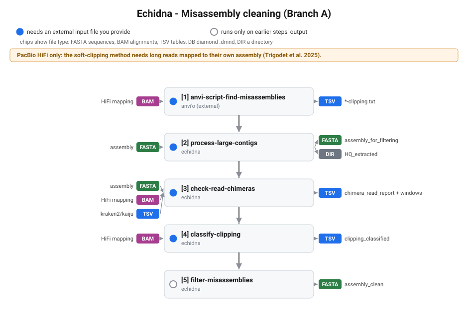
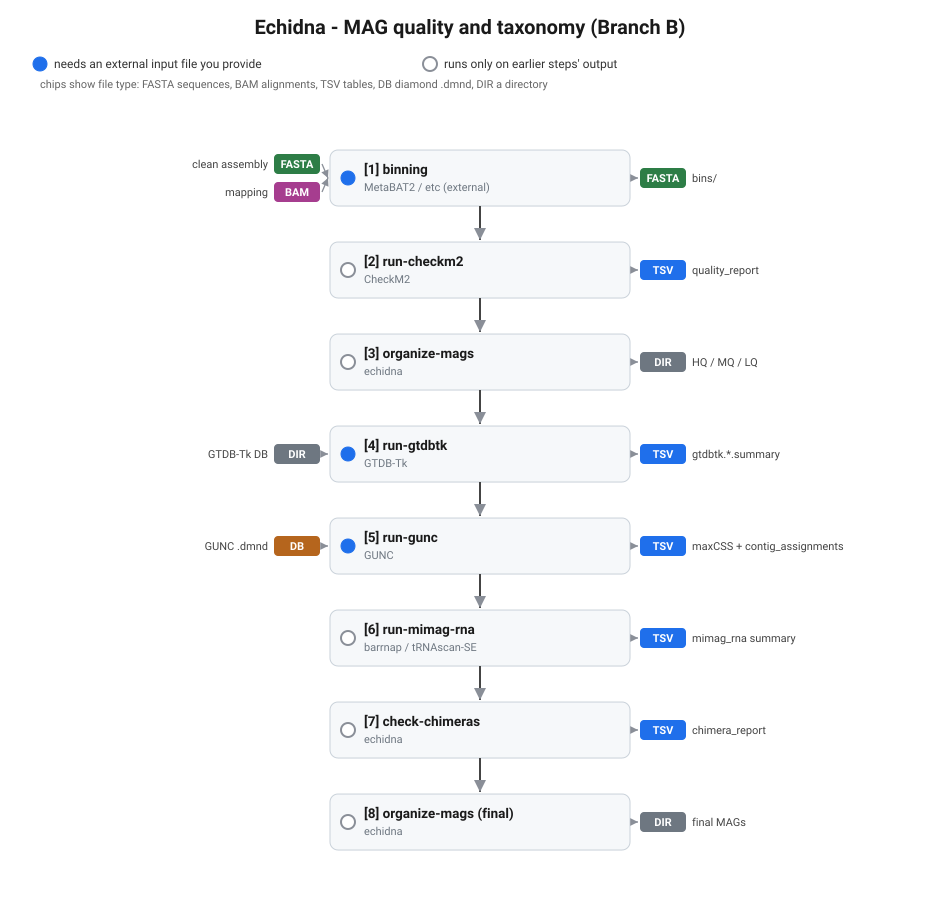

# Workflows

Echidna has two independent branches. Keep them separate: they answer different
questions and have different inputs.

- Branch A - Misassembly cleaning: take a raw assembly and the reads mapped back
  to it, find and split or remove misassembled/chimeric contigs, return a clean
  assembly. PacBio HiFi only (see below).
- Branch B - MAG quality and taxonomy: take bins, assess completeness and
  contamination, classify, check gene-level and composition consistency, and
  emit final MAGs sorted by quality tier.

You can run either branch on its own. Branch A feeds binning, whose bins start
Branch B, but if you already have bins you can skip straight to Branch B.

## Reading the diagrams

Each step is a node. The dot on its left says whether the step needs a file from
you:

- Filled dot: the step needs an external input file you provide (not produced by
  an earlier step). The incoming chip names the file type.
- Empty ring: the step runs only on the outputs of earlier steps - nothing new
  to supply.

Chips are colour-tagged by file type: FASTA (sequences), BAM (alignments), TSV
(tables), DB (a DIAMOND `.dmnd` database), DIR (a directory).

## Branch A - Misassembly cleaning

Only works with PacBio HiFi long reads. The method detects misassemblies from
soft-clipping of long reads mapped to the assembly they were built from
(Trigodet et al. 2025); short-read mapping does not give the same signal. Map
HiFi reads with `minimap2 -ax map-hifi`, keep supplementary alignments (do not
`-F 2048`), sort and index.



| Step | Command | External input (type) | Produces (type) | Env |
|---|---|---|---|---|
| 1 | `anvi-script-find-misassemblies` (external) | HiFi mapping (BAM) | `*-clipping.txt` (TSV) | anvio-9 |
| 2 | `process-large-contigs` | assembly (FASTA), misassemblies (DIR) | `assembly_for_filtering.fa` (FASTA), `HQ_extracted/` (DIR) | echidna (CheckM2 via `--checkm2-env`) |
| 3 | `check-read-chimeras` | assembly (FASTA), HiFi mapping (BAM), Kraken2/Kaiju per-read (TSV) | `chimera_read_report.tsv`, `chimera_read_windows.tsv` (TSV) | echidna |
| 4 | `classify-clipping` | HiFi mapping (BAM) | `clipping_classified.tsv` (TSV) | echidna |
| 5 | `filter-misassemblies` | none (uses steps 1-4) | `assembly_clean.fa` (FASTA) | echidna |

Steps 3 and 4 are optional but recommended: step 3 adds read-level taxonomy, step
4 labels each clipping position. Step 5 is the only required follow-up to step 2.

## Branch B - MAG quality and taxonomy

Assumes binning is done (external). The order matters: GUNC, check-chimeras and
run-mimag-rna must see the same genome names, so do not rename between them (see
[pipeline.md](pipeline.md)).



| Step | Command | External input (type) | Produces (type) | Env |
|---|---|---|---|---|
| 1 | binning (external) | clean assembly (FASTA), mapping (BAM) | `bins/` (FASTA) | - |
| 2 | `run-checkm2` | none (uses bins) | `quality_report.tsv` (TSV) | checkm2 |
| 3 | `organize-mags` | none (uses checkm2 + bins) | `HQ/ MQ/ LQ/` tiers (DIR) | echidna |
| 4 | `run-gtdbtk` | GTDB-Tk DB (DIR) | `gtdbtk.*.summary.tsv` (TSV) | gtdbtk |
| 5 | `run-gunc` | GUNC DB (`.dmnd`) | `*.maxCSS_level.tsv`, `*.contig_assignments.tsv` (TSV) | gunc |
| 6 | `run-mimag-rna` | none (uses selected; GTDB-Tk for `--split-by-domain`) | `mimag_rna` summary (TSV) | mimag |
| 7 | `check-chimeras` | none (uses gunc + checkm2 + gtdbtk) | `chimera_report.tsv` (TSV) | echidna |
| 8 | `organize-mags` (final) | none (renames + gates on all of the above) | final MAGs (DIR) | echidna |

For the second chimera signal at step 7, add a per-contig taxonomy pass
(`run-mmseqs-contigs` -> `classify-contigs`) and give check-chimeras
`--contig-taxonomy <out>.bins.tsv`; without it the verdict rests on GUNC alone
(a failing bin is then `Check`, not `Chimeric`). run-mimag-rna is optional
(full-MIMAG HQ gate).

## How to run

### One command per branch (`*-wf`, like `gtdbtk classify_wf`)

Each branch has a single command that chains its steps, calling every
sub-command in the right conda env for you. Run them from the `echidna` env.

```bash
# Branch A - misassembly cleaning (PacBio HiFi only)
echidna misassembly-wf \
    --assembly assembly.fa --bam hifi_mapping.bam -o misasm_wf/ --threads 40 \
    --anvio-env anvio-9 --checkm2-env checkm2 \
    --kraken2-output reads.kraken2 --kraken2-report report.txt   # optional taxonomy

# Branch B - MAG quality + taxonomy
echidna mag-quality-wf \
    --bins-dir bins/ -o mag_wf/ --threads 40 --tiers HQ,MQ \
    --gtdbtk-data /data/gtdbtk_r220 --gunc-db /data/gunc/gunc_db_gtdb214.dmnd \
    --mmseqs-db /data/mmseqs_gtdb/gtdb \
    --split-by-domain
```

Both accept `--dry-run` (print the commands without running), `--from <step>`
(resume after fixing a failure) and `--skip <step[,step]>`. The step keys are
printed by `--dry-run` and listed in [command-reference.md](command-reference.md).
`mag-quality-wf` freezes genome names after the first tiering so GUNC,
check-chimeras and run-mimag-rna all match (no rename until the final step). Pass
`--mmseqs-db <prefix>` to add the per-contig taxonomy signal (it inserts
`run-mmseqs-contigs` + `classify-contigs` and feeds check-chimeras
`--contig-taxonomy`, so a bin can reach a real `Chimeric` verdict). Alternatively,
provide `--contig-taxonomy <classify-contigs.tsv>` to reuse existing sequence-linked
assignments and regenerate the bin summaries. Without either source the verdict
rests on GUNC alone.

The `*-wf` commands shell out to `conda run -n <env> ...`, so the tool envs must
exist and have Echidna installed (including the anvi'o env, for
`run-anvi-misassemblies`). See [installation.md](installation.md).

### Per command (full control)

Run each command yourself in its env; see [pipeline.md](pipeline.md) for
copy-paste commands with real paths.

### Snakemake (one DAG, clusters)

`workflow/Snakefile` orchestrates Branch B end to end across the envs (target
`all` or the explicit `all_mag_quality`). Configure once with `setup-workflow`,
then `snakemake --cores N ...`. The misassembly branch is not in the Snakefile;
use `misassembly-wf` for it. See [`../workflow/README.md`](../workflow/README.md)
and [hpc.md](hpc.md).

## Regenerating the diagrams

The SVGs under `docs/img/` are produced by `docs/img/gen_diagrams.py`, a small
standalone script (no dependencies). Edit the step tables at the top of the
script and rerun it if the pipeline changes:

```bash
python docs/img/gen_diagrams.py docs/img
```


Current operational note: run anvi’o BEFORE `process-large-contigs`, since the latter consumes its clipping output. `classify-clipping` is report-only; quality organization does not apply a chimera exclusion policy. See [the maintained wiki](../wiki/Home.md).


## Optional shared-contig check

Before interpreting a combined MAG collection, run
`echidna check-shared-contigs --bins-dir bins/ -o overlap/`. For quality-tier
subfolders add `--recursive`; multiple input directories can be supplied after
`--bins-dir`. The standalone command reports identical complete sequences
(including renamed contigs and reverse complements) and ID conflicts separately.
By default it reports overlap without changing membership or chimera verdicts.
Optional `--exclude-mags` or `--remove-shared-contigs`, with `--quality-report`,
export a separate resolved collection. Cluster-aware replacements are available
with candidate FASTAs and dRep/generic cluster metadata. Trimmed MAGs require
quality reassessment. See [reports, resolution and examples](shared-contigs.md).

## Overlap resolution with existing contig taxonomy

The two MAG workflows can resolve a representative set **before** running final
QC. Supply previous quality estimates for ranking and sequence-linked per-contig
classifications covering representatives and candidate MAGs:

```bash
echidna mag-quality-wf --bins-dir drep/dereplicated_genomes/ -o mag_wf/ \
  --resolve-overlaps exclude-mags \
  --quality-report checkm2_all/quality_report.tsv \
  --contig-taxonomy all_contigs.classified.tsv --taxonomy-rank order \
  --drep-dir drep/ --candidates-dir all_original_mags/ \
  --gtdbtk-data /data/gtdbtk --gunc-db /data/gunc/gunc.dmnd \
  --threads 20
```

Use `--resolve-overlaps remove-contigs` for shared-copy removal. For other
dereplication tools replace `--drep-dir` with `--cluster-table clusters.tsv`.
The same FASTA extension is used for starting representatives and candidates;
resolved outputs use `.fa` and downstream commands receive that extension.

The order is:

1. Resolve overlap and test taxonomy before accepting each genome or substitute.
2. Check the actual exported FASTAs for overlap and taxonomy again.
3. Run CheckM2 on the resolved collection, then tier it with original filenames.
4. Run GTDB-Tk, GUNC and optional MIMAG RNA on the selected genomes.
5. Reaggregate the reused contig assignments on the selected genomes and feed
   the **new** per-bin summary to `check-chimeras` alongside the new GUNC report.
6. Organize final MAGs using the new QC results. The chimera verdict remains
   report-only; it is distinct from the explicit taxonomy acceptance gate.

No previous representative's bin-level taxonomy, GUNC or quality result is
copied onto a replacement. This workflow reuses classifier assignments, not
old bin statistics. Initial thresholds are `0.5` resolved/all-base fraction and
`0.05` foreign/resolved-base fraction; change them with
`--min-taxonomy-resolved-frac` and `--min-foreign-frac`. See the
[precise acceptance rules and legacy-table migration](shared-contigs.md#reuse-contig-taxonomy-when-selecting-replacements).

`mag-quality-wf` writes selection outputs under `00_overlap/`; other step names
are unchanged. Resume later steps with `--from checkm2` etc. Selection output
must be new or empty, so rerunning `overlap` into a nonempty directory is refused;
use a new output root or explicitly manage previous results. Omitting
`--resolve-overlaps` preserves the original workflow.

For Snakemake, the equivalent configuration is:

```yaml
genomes_dir: "drep/dereplicated_genomes"
genome_ext: "fa"
overlap_resolution: "exclude-mags"
overlap_quality_report: "checkm2_all/quality_report.tsv"
overlap_drep_dir: "drep"
overlap_candidates_dirs: ["all_original_mags"]
contig_taxonomy: "all_contigs.classified.tsv"
taxonomy_rank: "order"
min_taxonomy_resolved_frac: 0.5
min_foreign_frac: 0.05
```

`setup-workflow` accepts the same selection flags as the command example to
write those settings. Snakemake uses a checkpoint because replacement names
and counts are unknown before selection. It tracks representative/candidate
FASTA files and metadata tables, then rebuilds downstream QC if selection
changes. Its resolved collection is under `overlap_resolution/retained/`.
Without overlap resolution, `contig_taxonomy` can still enable the second
chimera signal by reaggregating existing classifications on the original bins.
