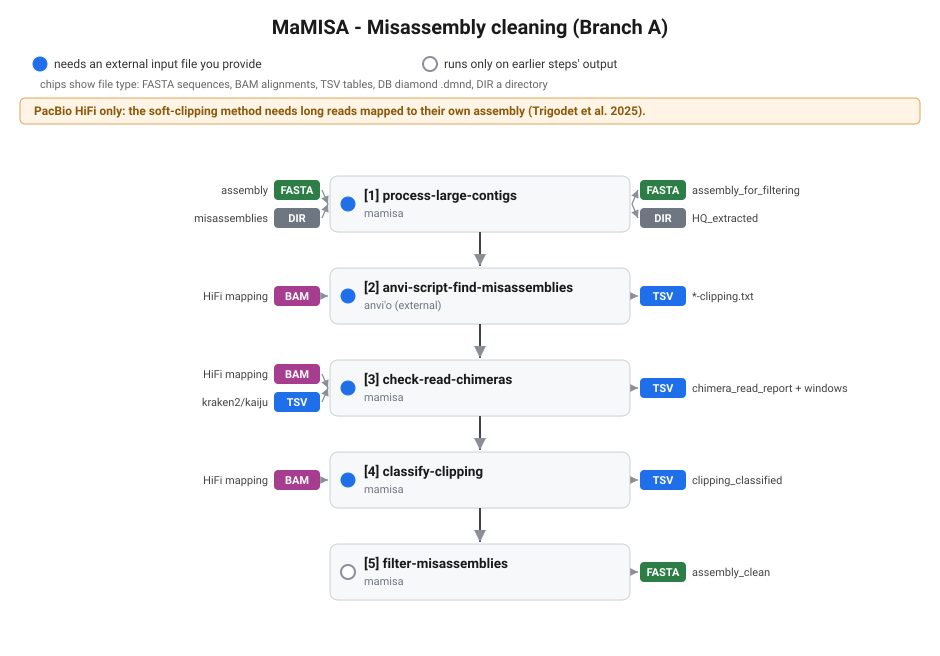
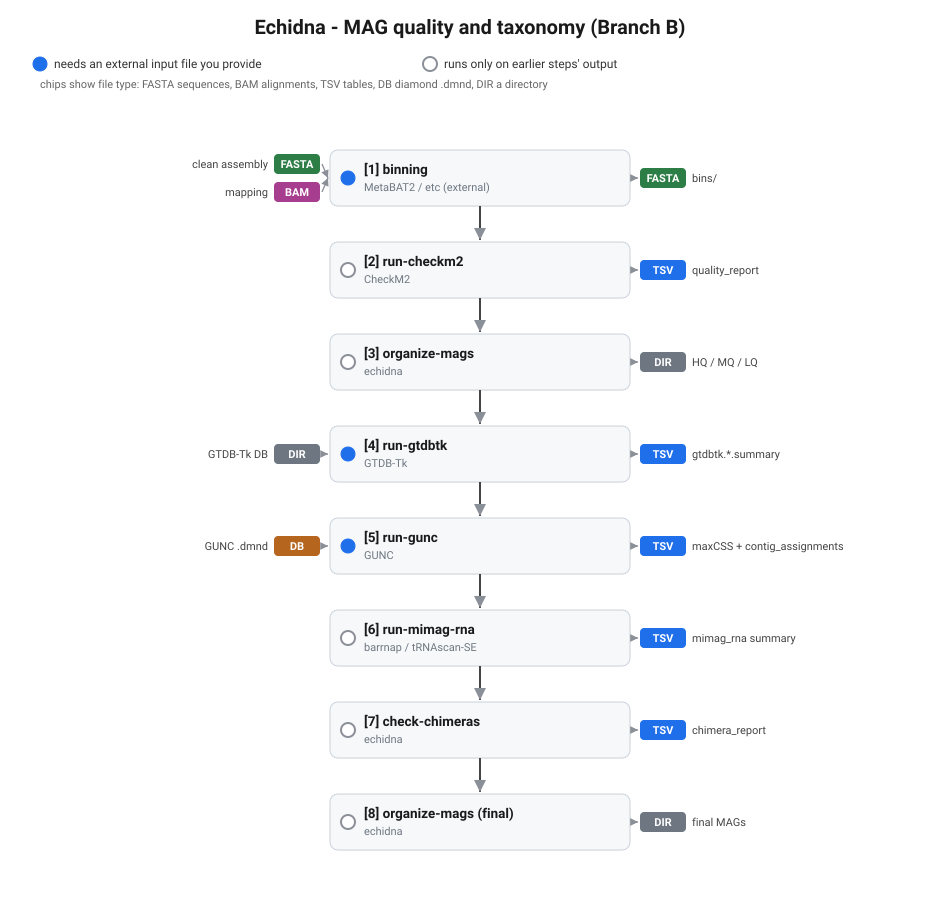

# Workflows

MaMISA has two independent branches. Keep them separate: they answer different
questions and have different inputs.

- Branch A - Misassembly cleaning: take a raw assembly and the reads mapped back
  to it, find and split or remove misassembled/chimeric contigs, return a clean
  assembly. PacBio HiFi only (see below).
- Branch B - MAG quality and taxonomy: take bins, assess completeness and
  contamination, classify, check gene-level and composition consistency, and
  emit final MAGs sorted by quality tier.

You can run either branch on its own. Branch A feeds binning, whose bins start
Branch B, but if you already have bins you can skip straight to Branch B.

## Reading the diagrams

Each step is a node. The dot on its left says whether the step needs a file from
you:

- Filled dot: the step needs an external input file you provide (not produced by
  an earlier step). The incoming chip names the file type.
- Empty ring: the step runs only on the outputs of earlier steps - nothing new
  to supply.

Chips are colour-tagged by file type: FASTA (sequences), BAM (alignments), TSV
(tables), DB (a DIAMOND `.dmnd` database), DIR (a directory).

## Branch A - Misassembly cleaning

Only works with PacBio HiFi long reads. The method detects misassemblies from
soft-clipping of long reads mapped to the assembly they were built from
(Trigodet et al. 2025); short-read mapping does not give the same signal. Map
HiFi reads with `minimap2 -ax map-hifi`, keep supplementary alignments (do not
`-F 2048`), sort and index.



| Step | Command | External input (type) | Produces (type) | Env |
|---|---|---|---|---|
| 1 | `process-large-contigs` | assembly (FASTA), misassemblies (DIR) | `assembly_for_filtering.fa` (FASTA), `HQ_extracted/` (DIR) | mamisa (CheckM2 via `--checkm2-env`) |
| 2 | `anvi-script-find-misassemblies` (external) | HiFi mapping (BAM) | `*-clipping.txt` (TSV) | anvio-9 |
| 3 | `check-read-chimeras` | HiFi mapping (BAM), Kraken2/Kaiju per-read (TSV) | `chimera_read_report.tsv`, `chimera_read_windows.tsv` (TSV) | mamisa |
| 4 | `classify-clipping` | HiFi mapping (BAM) | `clipping_classified.tsv` (TSV) | mamisa |
| 5 | `filter-misassemblies` | none (uses steps 1-4) | `assembly_clean.fa` (FASTA) | mamisa |

Steps 3 and 4 are optional but recommended: step 3 adds read-level taxonomy, step
4 labels each clipping position. Step 5 is the only required follow-up to step 1.

## Branch B - MAG quality and taxonomy

Assumes binning is done (external). The order matters: GUNC, check-chimeras and
run-mimag-rna must see the same genome names, so do not rename between them (see
[pipeline.md](pipeline.md)).



| Step | Command | External input (type) | Produces (type) | Env |
|---|---|---|---|---|
| 1 | binning (external) | clean assembly (FASTA), mapping (BAM) | `bins/` (FASTA) | - |
| 2 | `run-checkm2` | none (uses bins) | `quality_report.tsv` (TSV) | checkm2 |
| 3 | `organize-mags` | none (uses checkm2 + bins) | `HQ/ MQ/ LQ/` tiers (DIR) | mamisa |
| 4 | `run-gtdbtk` | GTDB-Tk DB (DIR) | `gtdbtk.*.summary.tsv` (TSV) | gtdbtk |
| 5 | `run-gunc` | GUNC DB (`.dmnd`) | `*.maxCSS_level.tsv`, `*.contig_assignments.tsv` (TSV) | gunc |
| 6 | `run-mimag-rna` | none (uses selected; GTDB-Tk for `--split-by-domain`) | `mimag_rna` summary (TSV) | mimag |
| 7 | `check-chimeras` | none (uses gunc + checkm2 + gtdbtk) | `chimera_report.tsv` (TSV) | mamisa |
| 8 | `organize-mags` (final) | none (renames + gates on all of the above) | final MAGs (DIR) | mamisa |

run-gunc at step 5 should use `--contig-taxonomy-output` so step 7 gets the
per-contig multi-clade signal. run-mimag-rna is optional (full-MIMAG HQ gate).

## How to run

### One command per branch (`*-wf`, like `gtdbtk classify_wf`)

Each branch has a single command that chains its steps, calling every
sub-command in the right conda env for you. Run them from the `mamisa` env.

```bash
# Branch A - misassembly cleaning (PacBio HiFi only)
mamisa misassembly-wf \
    --assembly assembly.fa --bam hifi_mapping.bam -o misasm_wf/ --threads 40 \
    --anvio-env anvio-9 --checkm2-env checkm2 \
    --kraken2-output reads.kraken2 --kraken2-report report.txt   # optional taxonomy

# Branch B - MAG quality + taxonomy
mamisa mag-quality-wf \
    --bins-dir bins/ -o mag_wf/ --threads 40 --tiers HQ,MQ \
    --gtdbtk-data /data/gtdbtk_r220 --gunc-db /data/gunc/gunc_db_gtdb214.dmnd \
    --split-by-domain
```

Both accept `--dry-run` (print the commands without running), `--from <step>`
(resume after fixing a failure) and `--skip <step[,step]>`. The step keys are
printed by `--dry-run` and listed in [command-reference.md](command-reference.md).
`mag-quality-wf` freezes genome names after the first tiering so GUNC,
check-chimeras and run-mimag-rna all match (no rename until the final step), and
passes `--contig-taxonomy-output` to GUNC automatically.

The `*-wf` commands shell out to `conda run -n <env> ...`, so the tool envs must
exist and have MaMISA installed (including the anvi'o env, for
`run-anvi-misassemblies`). See [installation.md](installation.md).

### Per command (full control)

Run each command yourself in its env; see [pipeline.md](pipeline.md) for
copy-paste commands with real paths.

### Snakemake (one DAG, clusters)

`workflow/Snakefile` orchestrates Branch B end to end across the envs (target
`all` or the explicit `all_mag_quality`). Configure once with `setup-workflow`,
then `snakemake --cores N ...`. The misassembly branch is not in the Snakefile;
use `misassembly-wf` for it. See [`../workflow/README.md`](../workflow/README.md)
and [hpc.md](hpc.md).

## Regenerating the diagrams

The SVGs under `docs/img/` are produced by `docs/img/gen_diagrams.py`, a small
standalone script (no dependencies). Edit the step tables at the top of the
script and rerun it if the pipeline changes:

```bash
python docs/img/gen_diagrams.py docs/img
```
